Pieces, in file order

1. [··Big picture](#overview)
2. [0Top comment](#piece-0)
3. [1Tuning knobs](#piece-1)
4. [2Similarity](#piece-2)
5. [3Read](#piece-3)
6. [4Stitch](#piece-4)
7. [5The engine](#piece-5)
8. [6Pair tables](#piece-6)
9. [7Pair columns](#piece-7)
10. [8Pair rows](#piece-8)
11. [9Embeddings](#piece-9)
12. [10Pair cells](#piece-10)
13. [11Rescue](#piece-11)
14. [12One table pair](#piece-12)
15. [13Output files](#piece-13)
16. [14Previews](#piece-14)
17. [15Main + CLI](#piece-15)
18. [→One cell's journey](#journey)

# table-segment.py, piece by piece

The 15,000-foot view of the file with a diagram for every piece. "English" means the original document and "Spanish" the translation. The code works for any language pair.

English (original) Spanish (translation) Table outline / key step

**You stopped at Piece 5.** [Continue from the engine](#piece-5)

Whole file · 2,249 lines

## The big picture: how the data changes shape

Two Azure DI JSON files go in. A list of "this English cell = that Spanish cell" pairs comes out, plus a list of cells that found no partner. Each stage hands a smaller, more precise problem to the next.

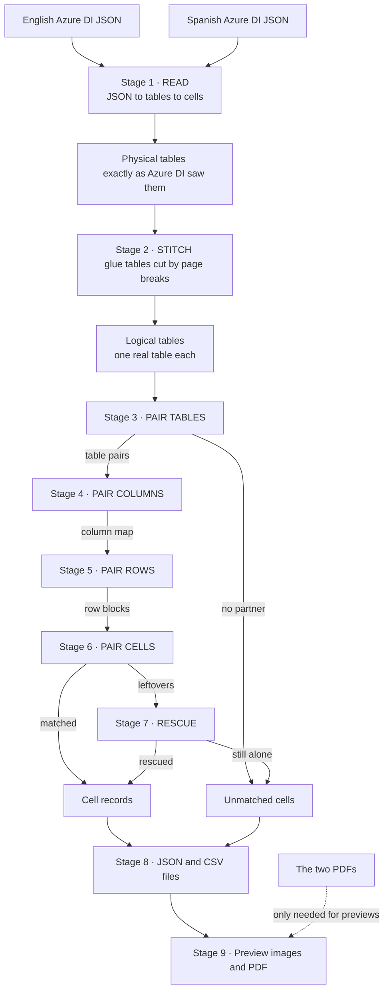

Stages 3 to 7 zoom in step by step: tables, then columns, then rows, then cells, then a second chance for leftovers.

Piece 0 · lines 1–160

## The long comment at the top

The file explains itself here: the problem, the nine stages, the cell tags, the output files and the commands. The diagram shows where this script sits next to the existing pipeline.

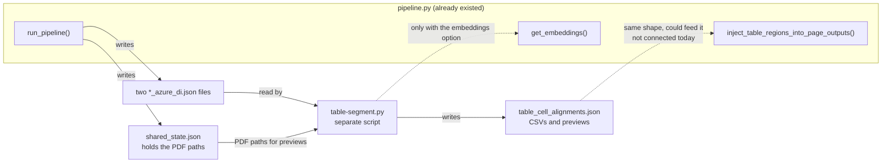

The dotted line to the pipeline is the important one: the output is shaped to fit, but nothing connects the two yet.

### Three things to know for your KT

- **It is a separate script.** It does not change `pipeline.py`. Someone still has to connect its output to the pipeline.
- **It cannot be imported normally.** Python cannot `import` a name with a hyphen. Lines 151–159 show how to load it by file path.
- **Its claimed results are unchecked.** The comment says 96% of English cells and 90% of Spanish cells get matched. That is what Copilot reported on your sample. Re-run it before you quote it.

Piece 1 · lines 184–247

## The tuning knobs

Every number that changes a matching decision sits in this one block, so nobody has to hunt through the code.

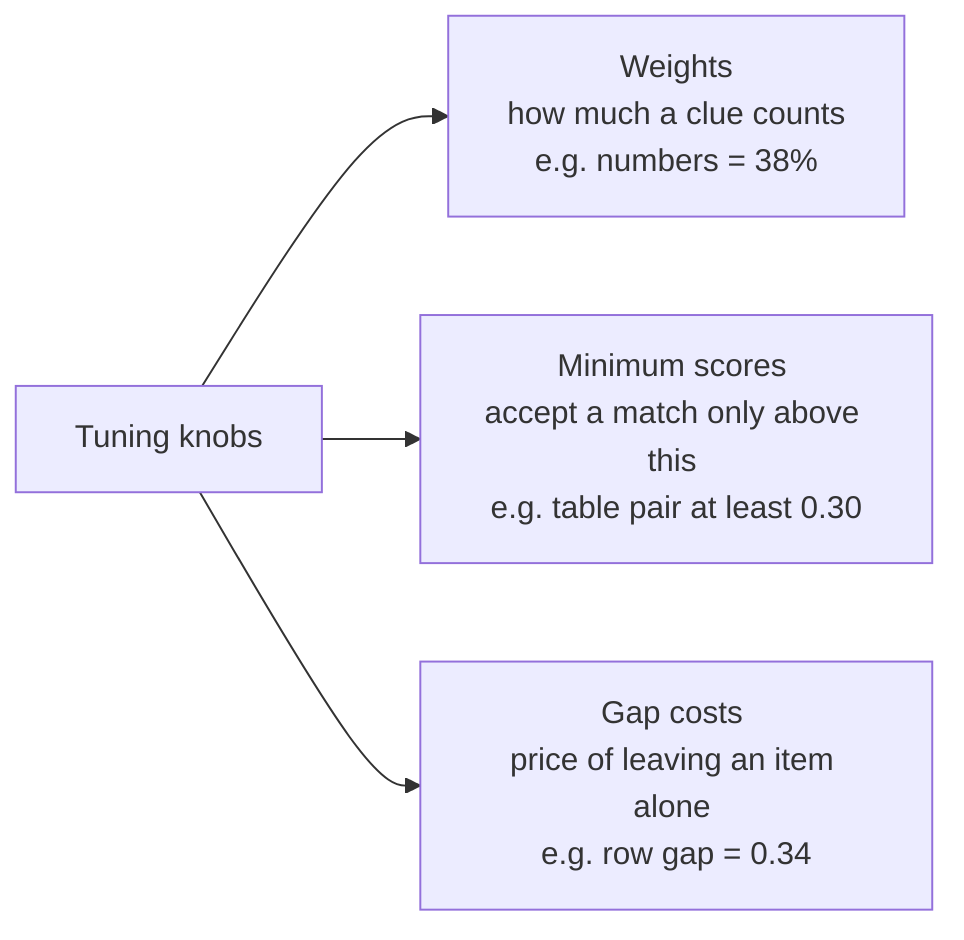

Three kinds of knob. Gap costs stop the code from forcing bad matches, and also from giving up too easily.

| Group | Key knobs |
| --- | --- |
| Similarity | numbers 0.38 · shared words 0.22 · letter chunks 0.28 · length 0.12 |
| Stage 2 stitch | header at least 80% similar · column drift at most 6% · at most 2 pages later |
| Stage 3 tables | gap 0.30 · minimum pair 0.30 · 2:1 merge only if each part is at least 0.45 |
| Stage 4 columns | gap 0.35 · header 50% / body 30% / position 20% |
| Stage 5 rows | gap 0.34 · minimum 0.10 · up to 3 rows merge · content 82% / position 18% |
| Stages 6 and 7 | flag below 0.35 · rescue needs 0.30 and at most 28% of table height apart |

These values were tuned on one English/Spanish sample. Another document type or language pair may need different values.

Piece 2 · lines 251–391

## The similarity toolkit

One question: **how alike are these two texts, when they are in different languages?** The answer is a score from 0 to 1. No translation and no internet are used.

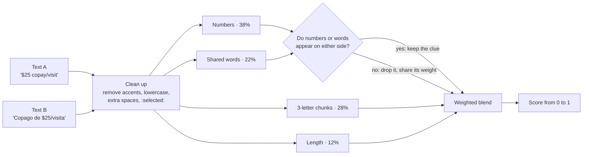

Chunks and length always count. Numbers and words count only when at least one side has them, so a cell with no digits is not punished.

### How the letter chunks catch similar words

"specialist"

spepececiciaialalilisist

"especialista"

espspepececiciaialalilisiststa

8 of the chunks are shared (in blue), so the two words score high even though they are in different languages.

### How numbers are compared

| English | Spanish | Read as | Match? |
| --- | --- | --- | --- |
| `$87.50` | `$87,50` | 87.5 and 87.5 | yes |
| `20%` | `$20` | percent 20 and plain 20 | no |

The limit: this works because English and Spanish share an alphabet. For Korean or Hindi, words and chunks share nothing, so only numbers and position are left. That is why the optional embeddings exist ([Piece 9](#piece-9)).

Piece 3 · Stage 1 · lines 395–639

## Read: JSON into tables and cells

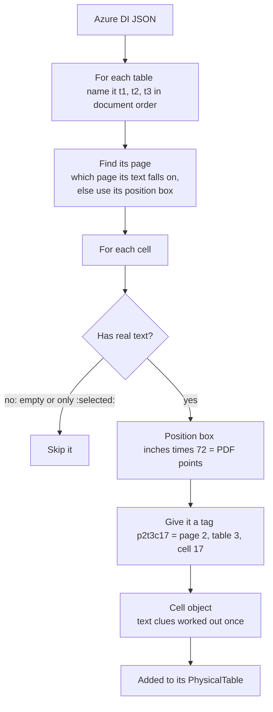

Key names are read in both spellings (row_index and rowIndex), because different Azure SDK versions write them differently.

### The three containers

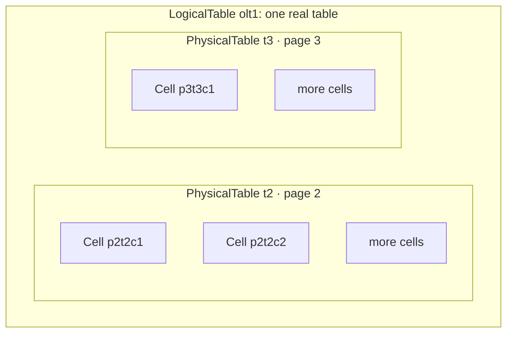

A Cell is one box. A PhysicalTable is a table exactly as Azure DI returned it. A LogicalTable is one or more physical tables glued together, and Stage 2 fills it.

The cell number in a tag is Azure's own order. Skipped empty cells leave gaps (c4, c6 with no c5). That is normal, not a bug.

Piece 4 · Stage 2 · lines 643–709

## Stitch: repair tables cut by page breaks

The script walks through the tables in reading order. For each one it asks: is this the rest of the previous table?

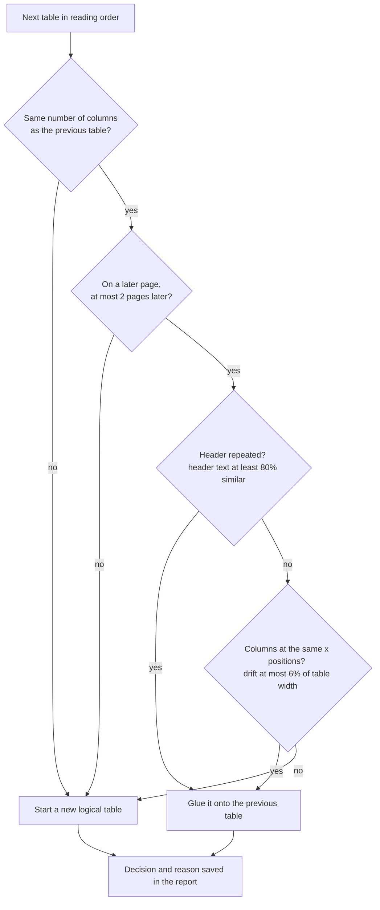

It only compares with the table just before. Every decision and its reason goes into the report, so a wrong glue is easy to trace.

### After gluing, rows are renumbered end to end

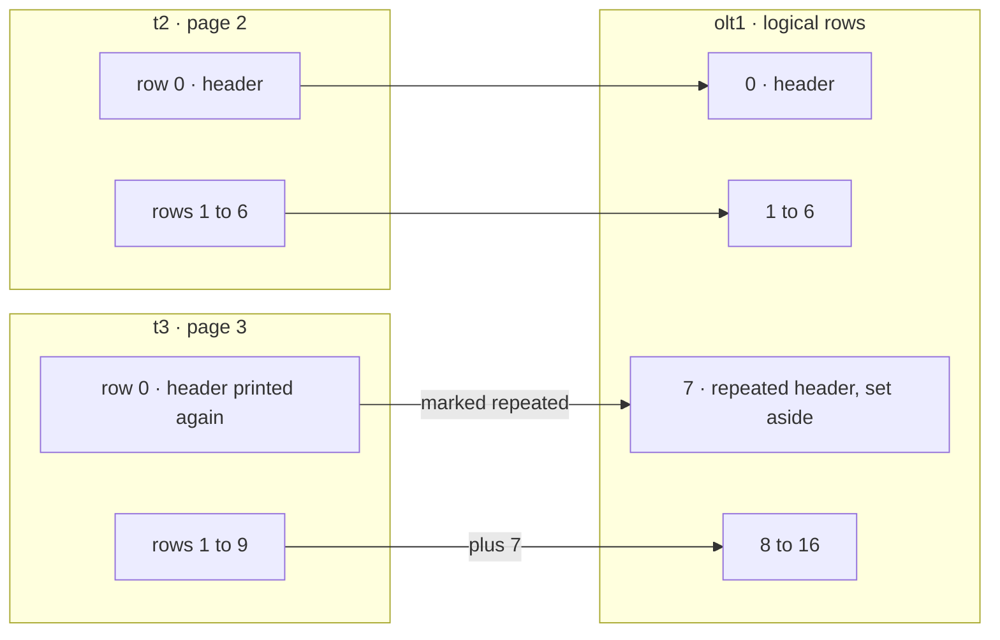

The second part's rows continue after the first part's. The header printed again on page 3 is page decoration, so it is kept out of row matching and paired separately later ([Piece 10](#piece-10)).

Logical tables get names like `olt1` (original logical table 1) and `tlt1` (translated logical table 1).

Piece 5 · lines 713–836 You stopped here

## The engine: pair two ordered lists without crossing

This is the most important piece. Stages 3, 4 and 5 all use it: for tables, for columns and for rows.

Picture two queues of people, one English and one Spanish, standing in the same order. You walk down both queues. At every step you pick one move, and you never pair someone near the front of one queue with someone near the back of the other.

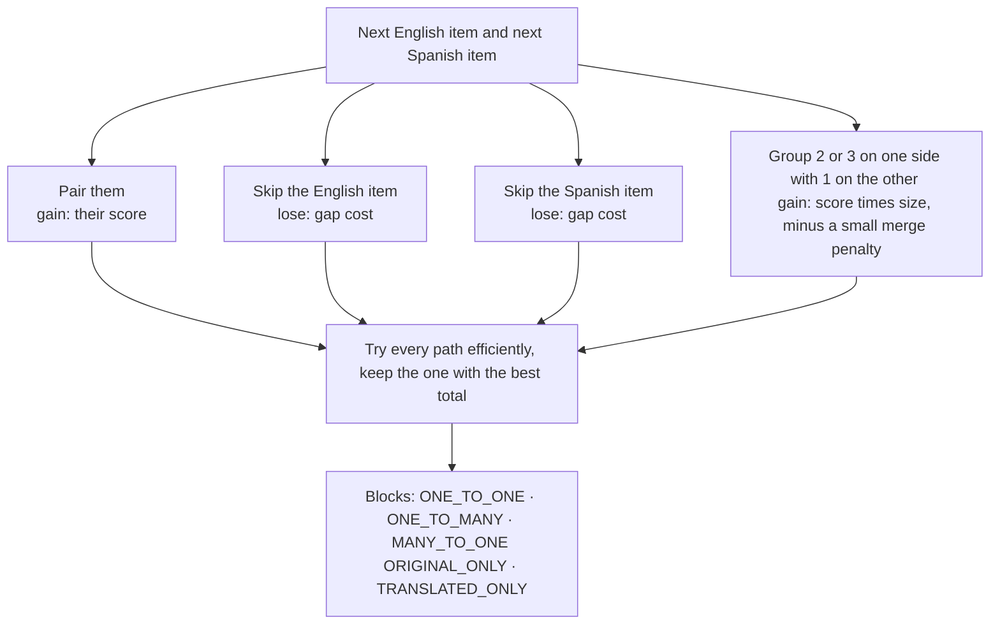

The four moves. A pair scoring below the stage's minimum is never allowed. This method is called dynamic programming; Git's diff and DNA alignment use the same idea.

### What a finished alignment looks like

OCR split one English row into two, so they merge onto one Spanish row (blue). One Spanish row has no English partner, so it is skipped and the gap cost is paid. No line ever crosses another. The row texts are an illustration, not real output.

### Helper 1: the position prior

Two items at the same relative spot get 1.0, for example both 30% of the way down their lists. The value drops as they drift apart. This lets rows with no shared words still land in the right place, held between the rows around them that do match.

### Helper 2: mutual-best sharpening (the "ratio test")

Cross-language scores bunch together, mostly between 0.3 and 0.6, so a clear winner and a runner-up look alike. Each score is multiplied by (its score ÷ the best competing score in its row or column). The winner keeps its score and runners-up shrink.

| Pair | Before | Best competitor | After | Against the 0.30 cut-off |
| --- | --- | --- | --- | --- |
| English A ↔ Spanish X | 0.60 | 0.60 | 0.60 | can pair |
| English A ↔ Spanish Y | 0.40 | 0.60 | 0.27 | blocked |
| English B ↔ Spanish X | 0.35 | 0.60 | 0.20 | blocked |
| English B ↔ Spanish Y | 0.55 | 0.55 | 0.55 | can pair |

Example numbers worked through the real formula. Before sharpening, all four pairs were above 0.30. After it, only the two clear winners are.

Piece 6 · Stage 3 · lines 838–927

## Pair tables

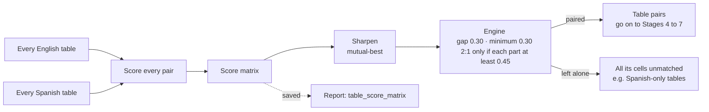

When two tables were paired wrongly, open the saved score matrix: it shows what the runner-up scored.

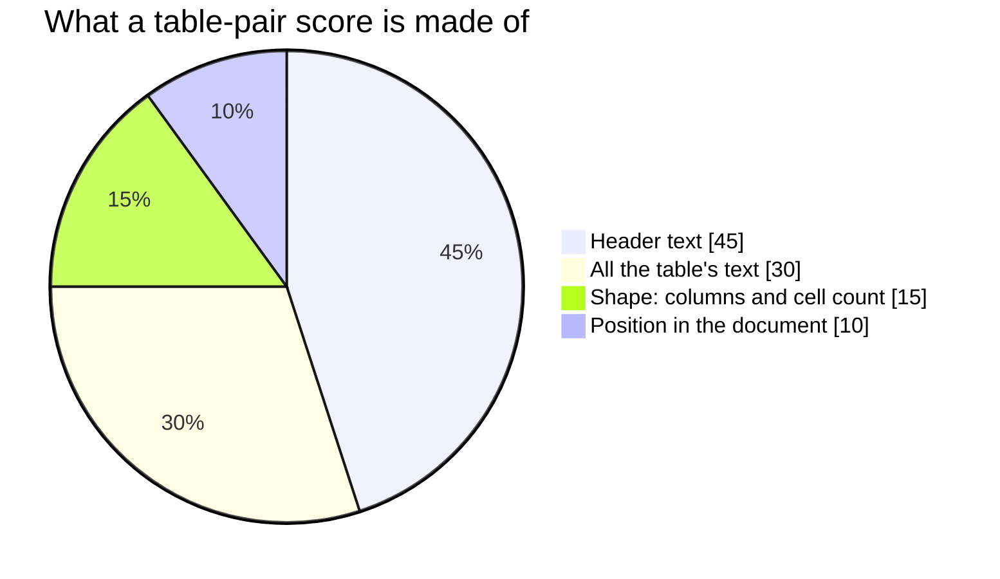

A table with no partner is not an error. The Spanish sample has tables that the English version writes as normal paragraphs, and the pipeline's paragraph matching handles that text. A 2:1 pairing is allowed for the case where Stage 2 missed a continuation.

Piece 7 · Stage 4 · lines 929–977

## Pair columns

This runs inside one table pair. Each column is described by its header text and its body text. Score = 50% header + 30% body + 20% position. Columns pair 1:1 only and never merge.

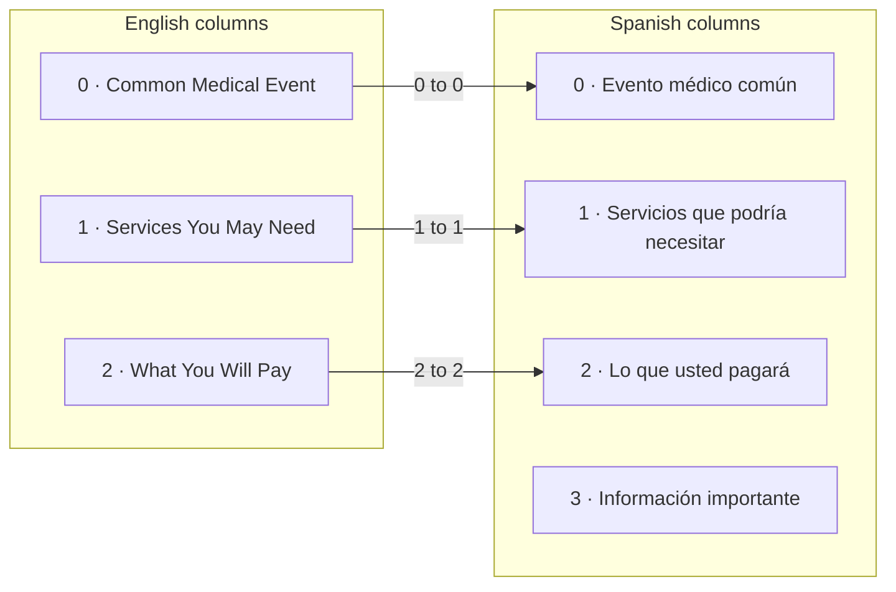

The result is a column map, here {0→0, 1→1, 2→2}. The extra Spanish column 3 has no partner and is left alone. The column names are an illustration.

Piece 8 · Stage 5 · lines 979–1150

## Pair rows: the heart of the file

This is the part your old paragraph logic struggled with. `RowView` arranges a table as rows, then columns, then cells, leaving out repeated headers. Then every candidate row pairing gets a score.

### How two rows are scored

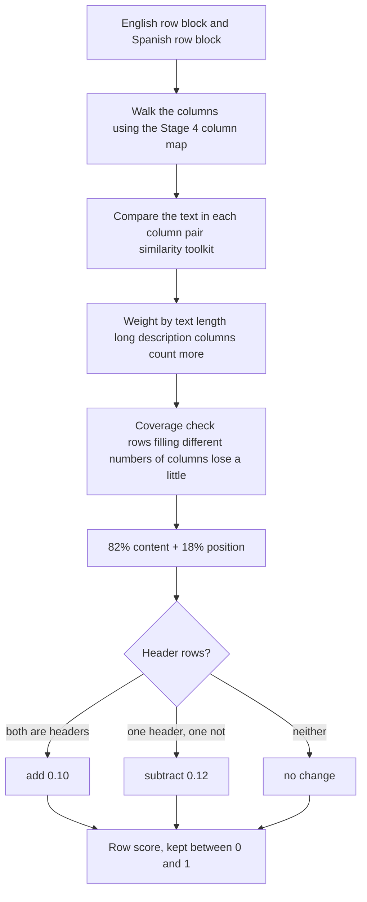

### The merge guard

The engine may merge up to 3 rows with 1, for rows that OCR split apart. But joining rows makes a score look better on its own, because more text means more chances to match a number. Without a guard the engine would merge everything, so every merge must pass this check:

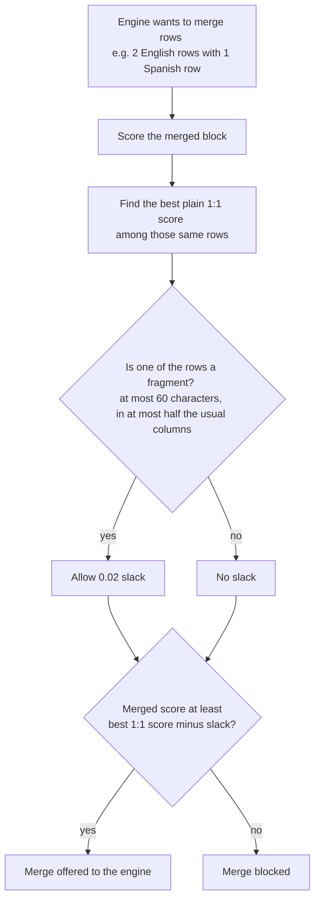

The real case it was built for: OCR split "Tier 2 – Your" and "Midrange-Cost Option" into two English rows, while the Spanish has one. A fragment is a tiny leftover row such as "especializada" alone on a line.

Piece 9 · lines 1152–1207

## Optional embeddings

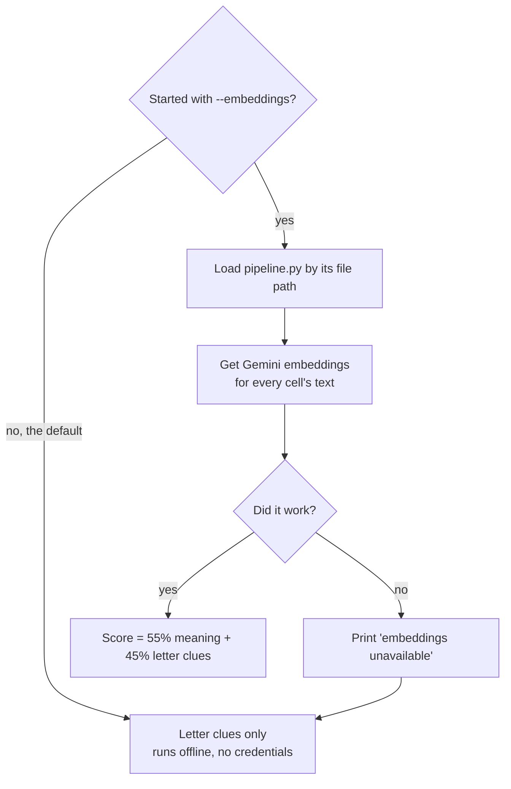

Off by default, because the script then runs with no internet or credentials, and for Spanish the letter clues are enough. Useful for languages with a different alphabet.

Piece 10 · Stage 6 · lines 1209–1360

## Pair cells

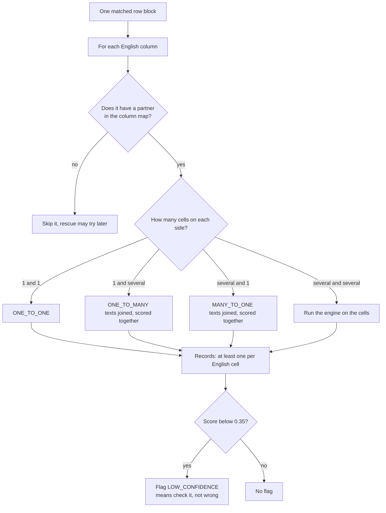

One record per cell, so no cell disappears silently. If 3 English cells match 1 Spanish cell, you get 3 records pointing at the same Spanish cell.

### What one record holds

#### Fields the pipeline already understands

- `original_cell_id`, `translated_cell_id`
- both texts, offsets and position boxes
- `mapping_source = "structural_table_segment"`
- `span_level_mapping`

#### Extra fields for checking

- `score`, `match_type`, `stage`
- `flags`, e.g. LOW_CONFIDENCE
- pages, table tags, row and column on both sides
- full id lists for merged groups

### Repeated headers are paired separately

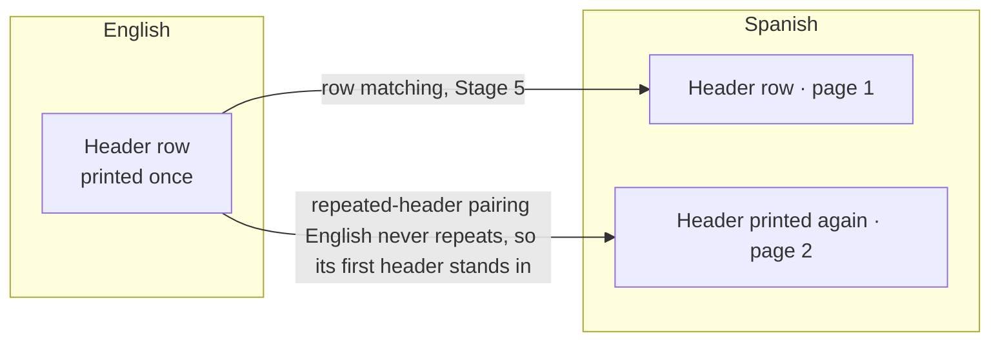

This is why the English header appeared twice in the test run. The 1st repeat pairs with the 1st repeat and the 2nd with the 2nd. If the counts differ they are spread evenly, and a side that never repeats lends its first header.

Piece 11 · Stage 7 · around lines 1360–1400

## Rescue: a second chance for leftovers

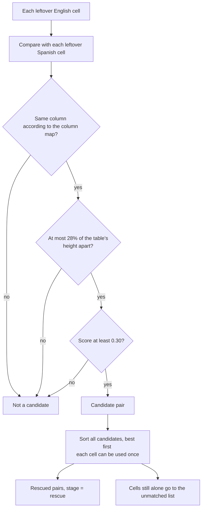

Piece 12 · lines 1465–1531

## One table pair, start to finish

`map_table_pair()` runs Stages 4 to 7 for one table pair. The order of calls:

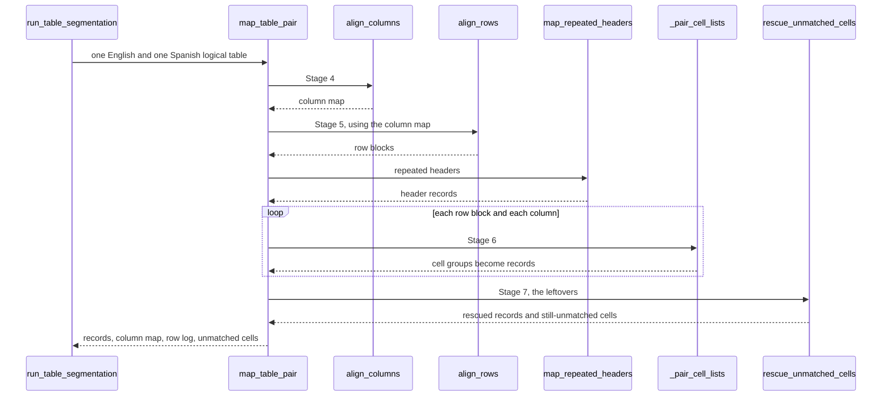

Piece 13 · Stage 8 · lines 1533–1691

## The output files

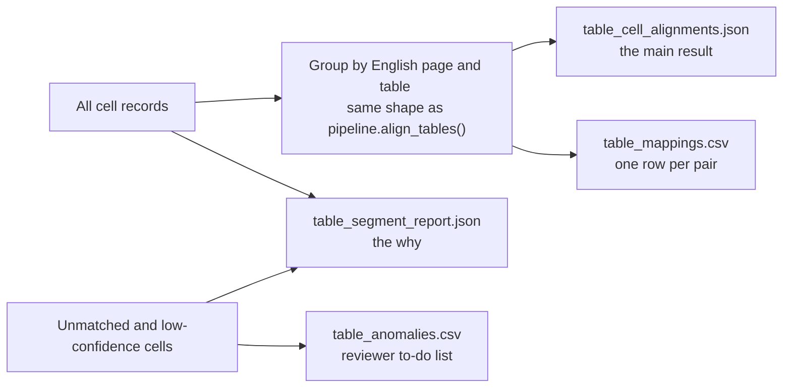

| File | What is in it | Open it when |
| --- | --- | --- |
| `table_cell_alignments.json` | All matched pairs plus summary numbers | You want the result, or other code needs it |
| `table_segment_report.json` | Stitching decisions, score matrix, row blocks, column maps, unmatched cells | You need to know why something matched or did not |
| `table_mappings.csv` | One row per pair. First columns match `reports/mappings.csv`. `numeric_agreement`: 1 = numbers agree, 0 = they do not | Reviewing in Excel |
| `table_anomalies.csv` | Unmatched cells on both sides, and low-confidence pairs | Giving reviewers a list to check |

The summary numbers include coverage (% of cells matched), average score, the low-confidence count and the unmatched counts.

Piece 14 · Stage 9 · lines 1694–1963

## Preview images

```mermaid
flowchart TD
  M["Cell records"] --> PP["Group into page pairs <br/>English page next to Spanish page"]
  PP --> RD["Turn both pages into images <br/>PyMuPDF at 200 dpi"]
  RD --> DR["Draw boxes <br/>red: English cell · green: Spanish cell <br/>blue: table outline · grey: unmatched"]
  DR --> LB["Tag label inside each box's top-left corner <br/>a Spanish cell shows its English partner's tag"]
  LB --> CB["Paste the two pages side by side"]
  CB --> JPG["One JPEG per page pair <br/>table_preview_opage_X_tpage_Y.jpg"]
  JPG --> PDF["All pages in one PDF <br/>table_alignment_output_previews.pdf"]
```

Page pairs come from the matches, not "page N next to page N", because the Spanish document is longer. If drawing fails, the rest of the run still succeeds.

The same tag on a red box and a green box means "these two cells are matched". A grey dashed box is a cell with no partner. This is a sketch, not a real preview.

Piece 15 · lines 1967–2248

## The main function and the command line

```mermaid
flowchart TD
  CMD["python table-segment.py with options"] --> A{"--original and --translated given?"}
  A -->|"yes"| USE["Use those two JSON files"]
  A -->|"no"| B{"--artifacts-dir given?"}
  B -->|"no"| ERR["Stop with an error"]
  B -->|"yes"| DISC["Find the two *_azure_di.json files <br/>the one named after the folder is English"]
  USE --> PQ{"PDF paths given?"}
  DISC --> PQ
  PQ -->|"no"| SS["Read PDF paths from shared_state.json"]
  PQ -->|"yes"| RUN["run_table_segmentation()"]
  SS --> RUN
  RUN --> ST["Stages printed as 1/9 to 9/9, <br/>then the files are written"]
```

When you are lost in the file, start at `run_table_segmentation()`: it calls every stage in order.

```
python table-segment.py --artifacts-dir <folder>
python table-segment.py --original A_azure_di.json --translated B_azure_di.json --out <folder>
```

Useful options: `--no-previews`, `--preview 20` (print 20 sample pairs), `--embeddings`, `--quiet`, `--render-dpi`.

Putting it together · from the test run

## One cell's journey

```mermaid
flowchart TD
  A["1 · Read <br/>'$25 copay/visit' gets the tag p1t1c6"] --> B["2 · Stitch <br/>the Spanish table split over 2 pages is glued into one"]
  B --> C["3 · Pair tables <br/>English table with the glued Spanish table"]
  C --> D["4 · Pair columns <br/>'What You Will Pay' with 'Lo que usted pagara'"]
  D --> E["5 · Pair rows <br/>row 1 with row 1: both have $25 and visit or visita"]
  E --> F["6 · Pair cells <br/>with 'Copago de $25/visita', score 0.66"]
  F --> G["8 · Output <br/>written to JSON and CSV, numeric_agreement = 1"]
  G --> H["9 · Preview <br/>red box and green box, both labelled p1t1c6"]
```

Stage 7 is not needed here: the cell was matched in Stage 6. The score of 0.66 comes from the number 25 agreeing and the chunks "cop" and "opa" matching.